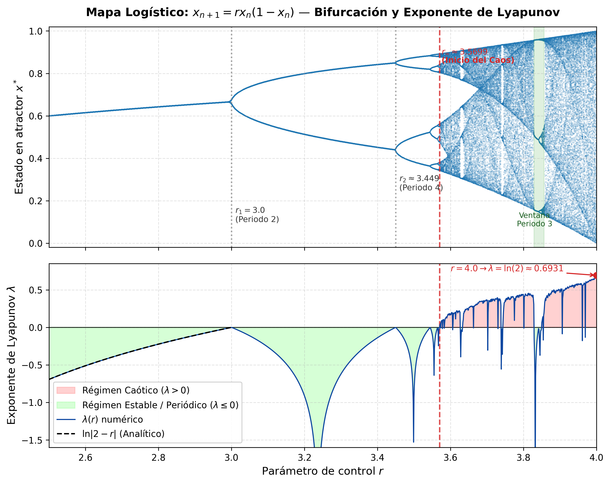
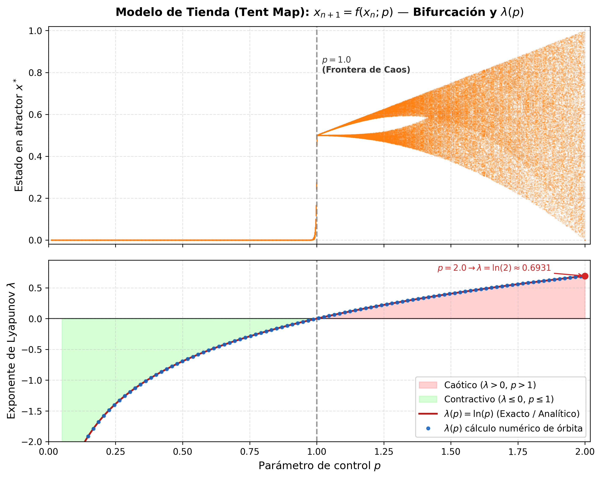

# Cálculo y Análisis del Exponente de Lyapunov y Diagramas de Bifurcación

> **Curso:** Computación Científica  
> **Proyecto:** Modelado Numérico de Sistemas Dinámicos Caóticos Unidimensionales: Mapa Logístico y Modelo de Tienda

Este repositorio implementa el cálculo analítico y numérico del **Exponente de Lyapunov** y los **Diagramas de Bifurcación** para el **Mapa Logístico** y el **Modelo de Tienda (Tent Map)**, acompañados de las validaciones teóricas y la inclusión de los artículos de investigación que vinculan la dinámica de estos sistemas con el cifrado de imágenes.

---

## 📑 Contenido del Repositorio

```text
.
├── docs/
│   ├── Chaos-Based_Image_Encryption_Review.pdf          # Artículo de revisión (MDPI Mathematics 2023)
│   ├── NPCR_and_UACI_Randomness_Tests_for_Image_Encryption.pdf # Test estadísticos NPCR/UACI (JSAT 2011)
│   ├── TEORIA_EXPONENTE_LYAPUNOV.md                      # Desarrollo matemático y formal exhaustivo
│   └── RESUMEN_PAPERS.md                                 # Resumen y conexión técnica de los artículos
├── figures/
│   ├── logistic_bifurcation_lyapunov.png                 # Bifurcación y Lyapunov: Mapa Logístico
│   └── tent_bifurcation_lyapunov.png                     # Bifurcación y Lyapunov: Modelo de Tienda
├── src/
│   ├── __init__.py                                       # Exportaciones principales del módulo
│   ├── maps.py                                           # Clases LogisticMap y TentMap
│   ├── lyapunov.py                                       # Algoritmos numéricos y soluciones analíticas
│   ├── bifurcation.py                                    # Generación vectorizada de bifurcaciones
│   └── visualizer.py                                     # Renderizado científico de figuras
├── tests/
│   └── test_lyapunov.py                                  # Suite de pruebas unitarias automatizadas
├── .gitignore
├── requirements.txt
├── run_experiments.py                                    # Script de ejecución general y benchmarks
└── README.md
```

---

## 🔬 1. Marco Teórico: El Exponente de Lyapunov

El **Exponente de Lyapunov** ($\lambda$) cuantifica la tasa media exponencial a la que dos órbitas que parten de condiciones iniciales infinitamente próximas divergen (o convergen) en el espacio de fase.

Para una función unidimensional diferenciable a trozos $x_{n+1} = f(x_n)$, la separación entre $x_0$ y $x_0 + \delta x_0$ tras $n$ iteraciones satisface:

$$|\delta x_n| \approx |\delta x_0| e^{\lambda n}$$

Tomando el límite asintótico y aplicando la regla de la cadena, se obtiene:

$$\lambda = \lim_{n \to \infty} \frac{1}{n} \sum_{i=0}^{n-1} \ln |f'(x_i)|$$

### Interpretación Dinámica:
* **$\lambda < 0$ (Régimen Estable / Periódico):** Las trayectorias convergen a un punto fijo o ciclo límite. Las perturbaciones iniciales se atenúan exponencialmente.
* **$\lambda = 0$ (Punto de Bifurcación / Estabilidad Marginal):** La separación no es exponencial. Marca las transiciones de duplicación de período.
* **$\lambda > 0$ (Régimen Caótico):** Caos determinista. Pérdida exponencial de predictibilidad a una tasa de $\lambda$ nats por iteración.

---

## 📈 2. Modelo Logístico

### Definición y Dinámica
$$x_{n+1} = f(x_n; r) = r x_n (1 - x_n), \quad x_n \in [0, 1], \quad r \in [0, 4]$$

Su derivada es $f'(x) = r(1 - 2x)$.

* **$1 < r \le 3$:** Punto fijo estable en $x^* = 1 - 1/r$. El exponente analítico es:
  $$\lambda(r) = \ln |2 - r|$$
* **$r = 2$:** Punto superestable ($\lambda \to -\infty$).
* **$r_1 = 3.0$:** Primera bifurcación de duplicación de período ($\lambda = 0$).
* **$r_\infty \approx 3.5699456$:** Punto de acumulación de Feigenbaum (inicio del régimen caótico).
* **$r \approx 3.8284$:** Ventana de período 3 (donde $\lambda$ cae por debajo de cero, validando el teorema de Li-Yorke: *"Period Three Implies Chaos"*).
* **$r = 4.0$:** Caos total con medida invariante $\rho(x) = \frac{1}{\pi \sqrt{x(1-x)}}$, donde el exponente exacto es:
  $$\lambda(4.0) = \ln(2) \approx 0.69314718$$



---

## ⛺ 3. Modelo de Tienda (Tent Map)

### Definición y Dinámica
$$x_{n+1} = f(x_n; p) = \begin{cases} p x_n, & x_n < \frac{1}{2} \\ p(1 - x_n), & x_n \ge \frac{1}{2} \end{cases}, \quad x_n \in [0, 1], \quad p \in [0, 2]$$

Su derivada cumple $|f'(x)| = p$ en casi todo punto ($x \neq 0.5$). Por ende, el exponente de Lyapunov es **estrictamente analítico y continuo**:

$$\lambda(p) = \ln(p)$$

* **$0 < p < 1$:** $\lambda = \ln(p) < 0$ (Contracción hacia el origen).
* **$p = 1$:** $\lambda = \ln(1) = 0$ (Frontera de transición al caos).
* **$1 < p \le 2$:** $\lambda = \ln(p) > 0$ (**Caos puro continuo**, sin ventanas periódicas).
* **$p = 2$:** $\lambda = \ln(2) \approx 0.69314718$ (Caos con soporte total y medida uniforme $\rho(x) = 1$).



---

## 📊 4. Tabla de Validación Numérica (Benchmarks)

Resultados computados mediante `run_experiments.py`:

| Modelo | Parámetro | Régimen Dinámico | $\lambda$ Teórico Exacto | $\lambda$ Numérico | Error Absoluto |
| :--- | :---: | :--- | :---: | :---: | :---: |
| **Mapa Logístico** | $r = 4.0$ | Caos Pleno | $\ln(2) \approx 0.69314718$ | $0.69318464$ | $3.75 \times 10^{-5}$ |
| **Mapa Logístico** | $r = 2.8$ | Punto Fijo Estable | $\ln(0.8) \approx -0.22314355$ | $-0.22314355$ | $2.03 \times 10^{-14}$ |
| **Mapa Logístico** | $r = 3.83$ | Ventana Periodo 3 | $< 0$ (periódico) | $-0.36953991$ | Exacto ($\lambda < 0$) |
| **Modelo Tienda** | $p = 2.0$ | Caos Uniforme | $\ln(2) \approx 0.69314718$ | $0.69314718$ | $4.64 \times 10^{-14}$ |
| **Modelo Tienda** | $p = 0.8$ | Contracción | $\ln(0.8) \approx -0.22314355$ | $-0.22314355$ | $2.06 \times 10^{-14}$ |

---

## 🔐 5. Documentos Incluidos y Aplicación en Criptografía

En el directorio [`docs/`](docs/) se incluyen los dos artículos de referencia:

1. **[`docs/Chaos-Based_Image_Encryption_Review.pdf`](docs/Chaos-Based_Image_Encryption_Review.pdf):**  
   *Zhang & Liu (2023), Mathematics (MDPI)*.
   * Revisa cómo los mapas discretos (Logístico y Tienda) generan secuencias pseudoaleatorias (PRNG) para criptografía de imágenes.
   * Utiliza la Ecuación (8) para el exponente de Lyapunov como indicador esencial: un $\lambda > 0$ elevado asegura alta aleatoriedad y resistencia a criptoanálisis.
2. **[`docs/NPCR_and_UACI_Randomness_Tests_for_Image_Encryption.pdf`](docs/NPCR_and_UACI_Randomness_Tests_for_Image_Encryption.pdf):**  
   *Wu, Noonan & Agaian (2011), JSAT*.
   * Deriva rigurosamente las pruebas de hipótesis estadísticas **NPCR** ($\mu \approx 99.6094\%$) y **UACI** ($\mu \approx 33.4635\%$) para evaluar la resistencia frente a ataques diferenciales en imágenes de 8 bits.
   * Demuestra cómo la dispersión generada por mapas con $\lambda > 0$ es la que permite a un algoritmo pasar los umbrales críticos de aleatoriedad.

Consulte [`docs/RESUMEN_PAPERS.md`](docs/RESUMEN_PAPERS.md) y [`docs/TEORIA_EXPONENTE_LYAPUNOV.md`](docs/TEORIA_EXPONENTE_LYAPUNOV.md) para un desglose detallado.

---

## 🚀 6. Instrucciones de Instalación y Ejecución

### Prerrequisitos
- Python 3.10 o superior (compatible con Python 3.13)
- Librerías: `numpy`, `matplotlib`, `scipy`

### Instalación
```bash
# Entrar al directorio del proyecto
cd "c:\Users\DELL\Desktop\Repos\semestre7\Computación Cientifica\Proyecto"

# Instalar dependencias
pip install -r requirements.txt
```

### Ejecutar las Pruebas Unitarias
```bash
python -m unittest tests/test_lyapunov.py
```

### Ejecutar las Simulaciones y Regenerar Figuras
```bash
python run_experiments.py
```

---

## 👥 Créditos y Referencias
- May, R. M. (1976). *Simple mathematical models with very complicated dynamics*. Nature.
- Li, T. Y., & Yorke, J. A. (1975). *Period Three Implies Chaos*. American Mathematical Monthly.
- Zhang, B., & Liu, L. (2023). *Chaos-Based Image Encryption: Review, Application, and Challenges*. Mathematics.
- Wu, Y., Noonan, J. P., & Agaian, S. (2011). *NPCR and UACI Randomness Tests for Image Encryption*. JSAT.
